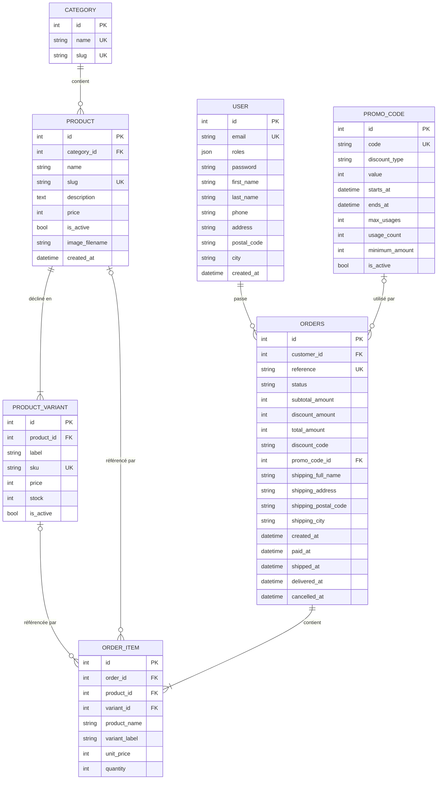

# Modèle de données du MVP

Dernière mise à jour : 2026-11-13

## Diagramme



## Entités

### Category (`category`)

| Colonne | Type | Contraintes |
|---|---|---|
| id | integer | clé primaire, auto-incrémentée |
| name | string(100) | obligatoire, unique (ADR 0008) |
| slug | string(120) | obligatoire, unique, généré à partir du nom à la création puis figé |

### Product (`product`)

| Colonne | Type | Contraintes |
|---|---|---|
| id | integer | clé primaire |
| category_id | integer | clé étrangère → category, obligatoire |
| name | string(150) | obligatoire |
| slug | string(170) | obligatoire, unique, généré à partir du nom à la création puis figé (ADR 0004) |
| description | text | facultatif |
| price | integer | obligatoire, en centimes, ≥ 0 ; prix de base, utilisé par les variantes sans prix propre |
| is_active | boolean | obligatoire, défaut `true` ; `false` = masqué du catalogue sans être supprimé |
| image_filename | string(255) | facultatif ; nom du fichier de la photo dans `public/uploads/products/`, généré aléatoirement (ADR 0010) ; vide = visuel de remplacement |
| created_at | datetime_immutable | obligatoire |

Le stock est porté par les variantes (ADR 0017) : tout produit en a au moins une.

Index du catalogue (ADR 0011), pour lire les produits actifs directement dans l'ordre demandé :

| Index | Colonnes | Sert à |
|---|---|---|
| idx_product_active_name | is_active, name | tri par nom (tri par défaut) |
| idx_product_active_created_at | is_active, created_at | tri par nouveautés |

Les tris par prix utilisent le plus petit prix des variantes actives (sous-requête) : ils n'ont pas d'index (ADR 0017).

### ProductVariant (`product_variant`)

Déclinaison d'un produit (couleur, format…). Un produit sans déclinaison a une seule variante « par défaut », sans libellé, invisible pour le client (ADR 0017).

| Colonne | Type | Contraintes |
|---|---|---|
| id | integer | clé primaire |
| product_id | integer | clé étrangère → product, obligatoire (`CASCADE` si le produit est supprimé) |
| label | string(100) | facultatif (vide = variante par défaut) ; obligatoire et unique dans le produit dès qu'il a plusieurs variantes (vérifié par le formulaire) |
| sku | string(64) | obligatoire, unique (référence de l'article) |
| price | integer | facultatif, en centimes, ≥ 0 ; vide = prix du produit |
| stock | integer | obligatoire, défaut 0, ≥ 0 |
| is_active | boolean | obligatoire, défaut `true` ; `false` = plus proposée aux clients |

La recherche (`LIKE '%…%'` sur `name` et `description`) ne peut pas utiliser d'index : voir ADR 0011.

### User (`user`)

| Colonne | Type | Contraintes |
|---|---|---|
| id | integer | clé primaire |
| email | string(180) | obligatoire, unique (identifiant de connexion) |
| roles | json | obligatoire (ex. `["ROLE_ADMIN"]`) |
| password | string(255) | obligatoire, **hash** du mot de passe |
| first_name | string(50) | obligatoire |
| last_name | string(50) | obligatoire |
| phone | string(20) | facultatif ; modifiable dans « Mon compte » |
| address | string(255) | facultatif ; modifiable dans « Mon compte » ou enregistrée depuis la commande (ADR 0013) |
| postal_code | string(10) | facultatif ; 5 chiffres, mêmes règles que l'adresse de livraison |
| city | string(100) | facultatif |
| created_at | datetime_immutable | obligatoire |

### Order (`orders`)

`order` est un mot réservé en SQL (`ORDER BY`) : la table s'appelle `orders`.

| Colonne | Type | Contraintes |
|---|---|---|
| id | integer | clé primaire |
| customer_id | integer | clé étrangère → user, obligatoire |
| reference | string(20) | obligatoire, unique (ex. `CMD-2026-00042`) |
| status | string(20) | obligatoire, valeurs de l'enum `OrderStatus` |
| subtotal_amount | integer | obligatoire, en centimes, somme des lignes avant remise |
| discount_amount | integer | obligatoire, défaut 0, en centimes, copie de la remise au moment de la commande |
| total_amount | integer | obligatoire, en centimes, sous-total − remise (montant facturé) |
| discount_code | string(30) | facultatif, copie du code promo utilisé (ADR 0016) |
| promo_code_id | integer | clé étrangère → promo_code, facultatif (`SET NULL`) ; sert à rendre l'utilisation à l'annulation |
| shipping_full_name | string(100) | obligatoire, copie au moment de la commande |
| shipping_address | string(255) | obligatoire, copie |
| shipping_postal_code | string(10) | obligatoire, copie |
| shipping_city | string(100) | obligatoire, copie |
| created_at | datetime_immutable | obligatoire |
| paid_at | datetime_immutable | facultatif (vide tant que non payée) |
| shipped_at | datetime_immutable | facultatif (vide tant que non expédiée) |
| delivered_at | datetime_immutable | facultatif (vide tant que non livrée) |
| cancelled_at | datetime_immutable | facultatif (vide sauf si annulée) |

États (`OrderStatus`) : `pending` (en attente de paiement), `paid` (payée), `shipped` (expédiée), `delivered` (livrée), `cancelled` (annulée).

Transitions autorisées (méthodes de `Order`, voir ADR 0007) :

```
pending ──markAsPaid()──▶ paid ──markAsShipped()──▶ shipped ──markAsDelivered()──▶ delivered
   │
   └──cancel()──▶ cancelled   (le stock est remis par OrderService::cancel())
```

### PromoCode (`promo_code`)

| Colonne | Type | Contraintes |
|---|---|---|
| id | integer | clé primaire |
| code | string(30) | obligatoire, unique, en majuscules |
| discount_type | string(20) | obligatoire, valeurs de l'enum `DiscountType` (`percentage`, `fixed_amount`) |
| value | integer | obligatoire ; pourcentage entier (1 à 100) ou montant en centimes |
| starts_at | datetime_immutable | facultatif |
| ends_at | datetime_immutable | facultatif |
| max_usages | integer | facultatif ; vide = illimité |
| usage_count | integer | obligatoire, défaut 0 ; commandes non annulées qui l'ont utilisé |
| minimum_amount | integer | facultatif, en centimes |
| is_active | boolean | obligatoire, défaut `true` |

### OrderItem (`order_item`)

| Colonne | Type | Contraintes |
|---|---|---|
| id | integer | clé primaire |
| order_id | integer | clé étrangère → orders, obligatoire |
| product_id | integer | clé étrangère → product, **facultatif** (`SET NULL` si le produit est supprimé) |
| variant_id | integer | clé étrangère → product_variant, **facultatif** (`SET NULL`) ; sert à remettre le stock à l'annulation |
| product_name | string(150) | obligatoire, copie au moment de l'achat |
| variant_label | string(100) | facultatif, copie du libellé de la variante (vide pour une variante par défaut) |
| unit_price | integer | obligatoire, en centimes, copie au moment de l'achat |
| quantity | integer | obligatoire, ≥ 1 |

## Relations

| Relation | Question 1 | Question 2 | Type | Clé étrangère |
|---|---|---|---|---|
| Category ↔ Product | Une catégorie a combien de produits ? Plusieurs | Un produit a combien de catégories ? Une | un-à-plusieurs | `product.category_id` |
| Product ↔ ProductVariant | Un produit a combien de variantes ? Au moins une | Une variante appartient à combien de produits ? Un | un-à-plusieurs | `product_variant.product_id` |
| ProductVariant ↔ OrderItem | Une variante apparaît dans combien de lignes ? Plusieurs | Une ligne concerne combien de variantes ? Une (ou aucune si elle a été supprimée) | un-à-plusieurs | `order_item.variant_id` |
| User ↔ Order | Un utilisateur a combien de commandes ? Plusieurs | Une commande a combien d'utilisateurs ? Un | un-à-plusieurs | `orders.customer_id` |
| Order ↔ OrderItem | Une commande a combien de lignes ? Plusieurs (au moins une) | Une ligne appartient à combien de commandes ? Une | un-à-plusieurs | `order_item.order_id` |
| PromoCode ↔ Order | Un code est utilisé par combien de commandes ? Plusieurs | Une commande utilise combien de codes ? Zéro ou un | un-à-plusieurs | `orders.promo_code_id` |
| Product ↔ OrderItem | Un produit apparaît dans combien de lignes ? Plusieurs | Une ligne concerne combien de produits ? Un (ou aucun s'il a été supprimé) | un-à-plusieurs | `order_item.product_id` |

## Décisions

- **Prix en centimes (`integer`)** : évite les erreurs d'arrondi des nombres à virgule.
- **Stock sur les variantes** (ADR 0017) : un seul chemin dans le code (panier, commande, annulation), y compris pour un produit sans déclinaison, grâce à sa variante par défaut.
- **Copies dans `orders` et `order_item`** (adresse, nom du produit, libellé de la variante, prix) : une commande est un document historique, elle ne doit pas changer si le produit, son prix ou l'adresse du client changent ensuite.
- **`total_amount` stocké** plutôt que recalculé : il fige le montant réellement facturé.
- **Remise copiée dans `orders`** (code, montant) : modifier ou désactiver un code ne change pas les commandes passées (ADR 0016).
- **Adresse dans `user`** : une seule adresse par client, qui préremplit l'adresse de livraison (ADR 0013). Suffisant pour le MVP. Une entité `Address` séparée sera envisagée si l'on veut plusieurs adresses par client.
- **Une catégorie ne peut être supprimée que si elle ne contient aucun produit** (même désactivé) : `product.category_id` est obligatoire.
- **Pas d'entité `Cart`** : le panier est stocké en session pour le MVP, sous la forme [identifiant de variante => quantité].
- **Photo des produits : seul le nom du fichier est en base** : l'image elle-même est un fichier sur disque (`public/uploads/products/`), servi directement par Nginx.
- **Codes postaux et téléphones en `string`** : ce ne sont pas des nombres (zéros initiaux, aucun calcul).
